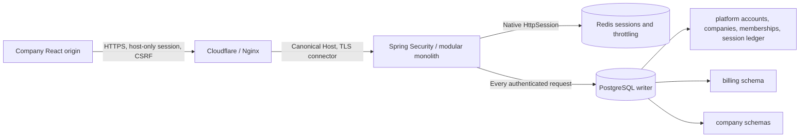
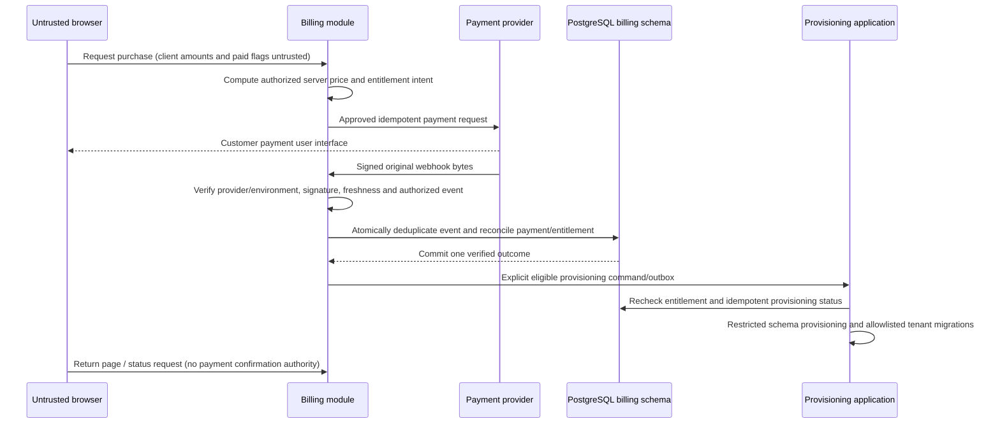
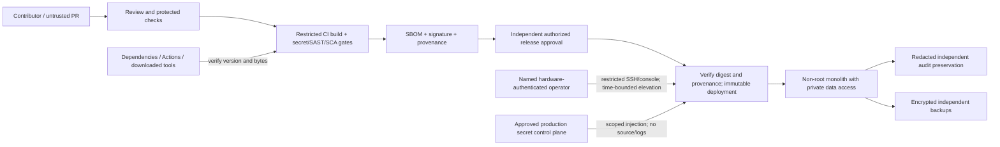

# Attack surface and trust boundaries

Phase 04 owner-approved session architecture, 2026-11-27. Source and tests are unexecuted. Read with [ADR-0004](../adr/0004-authentication-and-session-architecture.md), [threat model](threat-model.md), [requirements](security-requirements.md) and [handoff](phase04-authentication-foundation.md).

## System context and untrusted client boundary

The customer's OS, browser, extensions, React, local storage, cookies, headers and bodies are untrusted. Backend authority independently validates identity, current membership, entitlements and policy. Client roles/payment/tenant fields confer no authority. Shared process credentials and scoped routing are not hostile-process isolation. Existing tenant connection reset and cache naming remain intact. React prototype business/role storage is unchanged and is not backend authentication.



Edge transport, network policy and DNS/TLS ownership are operator duties and have not been verified. The connector must see TLS and the exact configured Host; forwarded headers are ignored. Authentication APIs are `/api/v1/auth/csrf`, `/register`, `/login`, `/session`, `/logout`. All other API endpoints deny until explicitly authorized. Management endpoints are not public under this chain; private probe exposure needs a separately reviewed policy.

## Authentication and session flow

```mermaid
sequenceDiagram
  participant B as Browser at company origin
  participant S as Native Spring Security
  participant P as PostgreSQL writer
  participant R as Spring Session Redis
  B->>S: GET csrf
  S->>R: Store synchronizer state, secure host cookie
  B->>S: POST login form + exact Origin + CSRF
  S->>R: Atomic account/source attempt budgets
  S->>P: Load account, native Argon2id verification
  S->>P: Create grant from active verified account, membership, company and entitlement
  Note over S,P: Password-only MFA-required access denies; Stage 03 uses a separate restricted factor flow
  S->>R: Rotate session ID and save credential-free SecurityContext
  S-->>B: 204, host-only cookie
  B->>S: GET session using cookie
  S->>R: Load unexpired HttpSession
  S->>P: Current grant, versions, policy and revocation
  S-->>B: Authorized account/company DTO
```

Logout commits PostgreSQL revocation before Redis invalidation/success. Account or membership disable/reactivate increments versions; stale Redis context never restores authority. Missing Redis state requires login. PostgreSQL outage prevents current authority decisions. Redis failure denies rather than using container-local sessions. Registration creates only PENDING/unverified accounts without membership; unavailable password screening denies registration. Sensitive mutations, jobs, step-up and independent approvals need transaction-level authority checks beyond this request boundary.

A valid stolen cookie can replay; this is an explicitly accepted residual risk without browser proof-of-possession equivalence. HttpOnly, TLS, rotation, short deadlines and revocation mitigate it; compromised same-origin code can still perform allowed actions. Company A's cookie is rejected at B even if manually supplied.

## WebAuthn and sibling trust

Future native Spring WebAuthn ceremonies use the exact company hostname as RP ID and exact HTTPS origin, with no parent-domain RP, wildcard or related-origin delegation. Separate company credentials and host-only sessions prevent a sibling origin from inheriting RP/cookie scope. A separate reserved privileged admin RP requires hardware assurance and its own policy. No factor endpoints exist yet; required MFA cannot be bypassed through password login or company switching. DNS ownership and hostname lifecycle still require operational evidence.

## Tenant authorization flow (proposed integration)

```mermaid
sequenceDiagram
  participant C as Browser or worker
  participant U as Application use case
  participant S as Central authority on PostgreSQL writer
  participant T as Tenant context and persistence adapter
  participant D as Tenant schema or scoped cache
  C->>U: Company-bound token and proof; untrusted resource selection
  U->>S: Validate native session or independently authorized worker identity, then current PostgreSQL grant, membership and entitlement
  S-->>U: Verified authority or deny
  U->>U: Validate ownership, fields, operation and required approvals
  U->>T: Bind validated company in an owned scope
  T->>T: Validate UUID/schema and context equality; verify/reset idle JDBC lease
  T->>D: Authorized routed operation using port
  D-->>T: Company-scoped result
  T->>T: Verify/reset/release connection; close scope on every outcome
  T-->>U: Authorized result only
```

For mutations, central authorization, operation approvals and tenant writes need an atomic commit fence; independent central/tenant transaction managers cannot be assumed atomic. Phase 07 must prove coordination while preserving idle-only provider handoff and cleanup. No unrestricted role switching, global Hibernate customizer, public-schema fallback or raw connection escape is proposed. Current foundations support routing only; stronger PostgreSQL-enforced company privileges remain separately required.

## Payment verification and provisioning (future Phases 06–07)



Provider callbacks are public-by-reachability, cryptographically authenticated inputs with replay protection, not browser sessions. Provisioning is never authorized by a frontend confirmation. Expired subscriptions restrict applicable operations while retaining data. Inventory, invoices, taxes, refunds, discounts and ledger invariants remain server domain rules under company scope. Provider side effects are reconciled; PostgreSQL/Redis/provider operations are not one atomic transaction.

## Administration, CI/CD and credential flows



No remote deployment, branch settings or signing mechanism is asserted implemented. Existing workflows have read-only contents permissions and Gitleaks/Trivy steps; Actions are version-tagged and scanner downloads lack visible integrity verification. SonarCloud/DAST, mandatory hosted checks, signing and provenance need verification/delivery. Workflow presence is not evidence of successful CI or full coverage.

| Credential/data flow | Allowed destination and owner | Prohibited exposure / recovery |
| --- | --- | --- |
| Email/password | HTTPS to same-origin identity handler; Argon2id digest/salt/parameters in platform security storage; identity owner. | No raw persistence, telemetry, URL, notification or frontend cache. Reset/revoke on compromise. |
| WebAuthn challenge/response | Public-key ceremony between exact company origin, authenticator and backend; server validates purpose/expiry/UV/signature. | No biometric/PIN collection; no wildcard origin; consumed challenge cannot replay. |
| Company session cookie | __Host-HICHSESSION to its exact company HTTPS host, Secure/HttpOnly/Path=/, no Domain. | Native CSRF/exact Origin, rotation, idle/absolute limits and current PostgreSQL authority. Valid stolen cookies may replay until constrained or revoked. |
| TOTP/recovery | TOTP secret encrypted under separately managed keys; recovery code verification hashes; identity owner. | No plaintext logging/notification; atomically single-use recovery and TOTP accepted steps. |
| Database runtime/migrator | Separate scoped injected secrets to runtime/Flyway; data/release owners. Current startup receives both credentials. | No administrator fallback, client access or production/dev reuse. Process compromise can reach injected secrets; future release-time migration isolation needs review. |
| Redis credentials | Scoped cache/security service users with reviewed ACLs and TLS; infra owner. | TenantCache is not a security-state API; logical indexes/prefixes are not ACL isolation. Rotate compromise. |
| Provider/webhook/notification keys | Backend provider adapter or verifying endpoint only; billing/notification owner. | No React key material, payment trust from return pages or unrestricted SSRF. Rotate with provider reconciliation. |
| Encryption/backup keys | Independently managed application-secret/encryption/backup keys with scoped rotation; operations owner. | No source/log exposure, cross-environment reuse or untrusted PR secret access. No browser access-token signing key is needed. |
| Recovery epoch and revocation evidence | Restricted deployment configuration and independent audit preservation; operations with independent review. | Must survive outside a restored database; cannot reopen from a stale snapshot or old writer. |

## Classification and sensitive asset inventory

| Class | Assets | Handling / trust limit |
| --- | --- | --- |
| Public | Reviewed static assets, marketing, public-key algorithm metadata. | Integrity/CSP/SRI and release review still required; public does not mean executable content trusted. |
| Internal | Topology, module contracts, non-sensitive operations telemetry. | Least-privilege operator access; avoid unnecessary detailed errors. |
| Confidential | Company inventory, invoices, customer/staff details, file contents, tenant membership/roles and subscription state. | Company/object/field checks, transport/storage encryption by classification, minimized retention, no shared-browser offline cache. |
| Restricted authentication | Password hashes, encrypted TOTP secrets, recovery code hashes, live session credentials, authentication/approval records. | Narrow identity access; credentials redacted; short scoped lifetimes; terminal revocation. Hashes/ciphertext remain sensitive. |
| Restricted operations | DB/Redis/provider keys, SSH/deployment authority, backup/envelope keys and recovery epoch controls. | Separate environments, independent approvals, restricted secret injection, audit and rotation; process/administrator compromise remains broad. |
| Evidence | Security logs, revocation/policy journals, backup catalog, provenance and restore records. | Redaction, integrity/tamper evidence, independent preservation, explicit retention and access review. |

Data owners classify each new ERP field/file before release. Applicable legal retention obligations and final retention periods require owner review; no regulatory compliance claim is made.

## Endpoint and network exposure inventory

Authentication routes are defined in the Phase 04 handoff; all other route classes below remain future work and are denied by default.

| Exposure | Route/component class | Required enforcement / responsible owner |
| --- | --- | --- |
| Public static | hich.com public entry and each company origin’s reviewed React assets. | Safe rendering/TLS, exact Host/company registry; no authority in static roles/storage. ERP remains on dedicated company URL; APIs independently authenticate. |
| Public entry, restricted effect | Company same-origin csrf/register/login; future verification/recovery/factor endpoints remain disabled. | Exact HTTPS Host/Origin, native CSRF, bounded account/source throttling, pending-only registration and MFA fail-closed; identity owner. |
| Authenticated private API | GET session and POST logout at the issuing company host. | Native SecurityContext, current PostgreSQL versions/membership/entitlement/revocation; all future business endpoints require explicit policy. |
| Privileged/step-up API | Role grants, factor changes, critical financial/recovery/administrative operations. | Fresh qualifying assurance, single-use bound approvals, separation of duties; identity/ERP/operations. Reachability alone grants nothing. |
| Provider ingress | Payment webhook. | Separate signature/original-byte/freshness/idempotency checks; Phase 06 billing. No global security bypass for provider routes. |
| Private service | PostgreSQL, Redis, internal operational probes and admin interfaces. | Network allowlists/TLS/least-privilege service identities; infra. Private network location is not user authorization. |
| Restricted admin | Reserved separate admin.hich.com origin/RP under restricted entry, plus SSH/console/deployment. | Hardware-bound admin assurance, no company session confers admin authority, independent critical approval. Separate registrable-domain benefit remains reviewed decision; same backend is common trust. |
| Background/internal | Module contracts, workers, migrations/provisioner. | Explicit application ports, independent delegated authority, safe schema selection and least-privilege runtime; backend/data. No public raw SQL/Redis interface. |

| Network path | Current evidence | Proposed production policy |
| --- | --- | --- |
| Internet → edge/origin | No production deployment verified. | Public HTTPS 443 through Cloudflare; HTTP only controlled redirect without sensitive exchange. Origin firewall/TLS admits approved edge path. |
| Nginx → Spring | App config port 8080; proxy deployment is future. | Private TLS upstream with canonical Host visible to the connector and no client forwarding authority; no direct public 8080. |
| Application → PostgreSQL/Redis | Env-provided host/ports; dev/test scripts and services exist. | Private approved flows only, TLS and minimal credentials; no public data ports. Do not infer live grants/ACLs. |
| Dev/CI data services | backend-ci.yml maps PostgreSQL 5432 and Redis 6379 in ephemeral job; CI Redis password is empty. | Ephemeral test setup is not a production policy. No infrastructure changes here. |
| Admin → server | No production administrative setup verified. | Restricted entry/VPN or equivalent reviewed path, hardware-backed SSH, named identities. Exact mechanism remains Phase 12 decision. |
| Runtime → providers/dependencies | Provider clients not implemented. | Purpose-specific allowlists, DNS/redirect validation and outbound limits; build registries separate from runtime egress. |
| Backups/audit export → independent storage | No production backup/log deployment verified. | Encrypted authenticated transfer, independent credentials, no app delete privilege and tested recovery. |

## Boundary enforcement register

| Boundary ID | Crossing and component trust | Enforcement responsibility and verification |
| --- | --- | --- |
| TB-01 | Untrusted OS/browser/React → internet entry. | Backend owns identity/CSRF/input/authorization; frontend/infra own safe rendering/TLS. Local role/admin manipulation cannot increase authority (AC-01, AC-17). |
| TB-02 | Internet/Cloudflare → origin Nginx. | Infra verifies origin TLS, restricts direct access and WAF/DDoS controls; edge is semi-trusted forwarding infrastructure (AC-21). |
| TB-03 | Proxy headers/framing → Spring API. | Infra/backend validate exact Host, trusted proxies, sizes, methods and parser consistency; never trust client forwarding headers (AC-18, AC-21). |
| TB-04 | Monolith authority/routing → PostgreSQL schemas. | Backend identity/data owners validate writer state/membership and application permissions, then safe routing/cleanup. Database grants independently restrict SQL capabilities; shared grants do not isolate companies from hostile process code (AC-02, AC-16, AC-20). |
| TB-05 | Application → Redis sessions/limiters/cache and PostgreSQL authority. | Spring Session stores HttpSession separately from tenant cache contracts. PostgreSQL checks versions/revocation on every use. Required-store failure denies; Redis loss never reconstructs authority. Operator must protect TLS/ACL/key scopes (AC-08, AC-15, AC-20, AC-S-04). |
| TB-06 | Module/request → worker, file storage or another module. | Respective application owners enforce contracts, scope, reauthorization, file validation and bounded work; trusted workers must still validate payload authority (AC-18, AC-19). |
| TB-07 | Untrusted client/provider messages → billing/provisioning. | Billing cryptographically verifies original webhook bytes and authoritative state; provisioning checks eligibility independently. A signature establishes provider evidence, not company membership or business permission (AC-03). |
| TB-08 | Human administrator/support → production or privileged company actions. | Operations/identity/tenant admins enforce named scope, hardware assurance, step-up and independent approvals. Customer device administrator is outside this boundary (AC-05, AC-12, AC-13, AC-21). |
| TB-09 | Contributor/registry/CI → trusted release/runtime. | Release owner enforces review, mandatory gates, byte verification, provenance and authorized deployment (AC-22). Build code is not trusted merely because GitHub runs it. |
| TB-10 | Application/security state → external notifications/providers. | Notification/billing owner minimizes data, authenticates outbound destination and prevents SSRF/credential exposure (AC-14, AC-18). |
| TB-11 | Runtime/database → evidence/backups → restored service. | Operations owns independent encrypted preservation, tamper detection, new recovery epoch and verified reconciliation before reopening (AC-08, AC-23). |
| TB-12 | Company origin ↔ API and malicious sibling origins. | Independent host-only cookies and exact Host/Origin/RP. No parent-domain RP/cookie, cross-company session, credential handoff or automatic SSO. Same-site is not trust (AC-17, AC-S-01/02). |

Network segmentation limits reachability. Application authorization governs principal/company/action/resource/field authority. PostgreSQL/Redis server privileges govern what a process credential may do; current shared identities span companies. Cryptographic verification establishes specific facts such as key possession, signed provider bytes or artifact origin; it does not replace membership, policy or trustworthy client display. None substitutes for another boundary.

## Separation of duties and practical development exceptions

| Context | Current/future distinction | Required independent control and release gate |
| --- | --- | --- |
| Solo local development | One developer may author/run/review local documentation and synthetic fixtures. This is disclosed, not independent assurance. | No claim of two-person review or production authorization. Required CI is never bypassed; no secrets/production operations are authorized by this task. |
| Production administration | Future named operator role, distinct from application tenant user. | Hardware-backed authentication, time-limited privilege, audited scope and independent review of critical changes. Lack of personnel is an unresolved readiness/resource blocker. |
| Tenant company administration | Company owner/admin acts only within verified memberships and delegated permissions. | Cannot self-grant platform authority, lower mandatory MFA or approve own selected critical grant. Tenant policy can be stricter. |
| Critical finances | Cashier/requester/approver are distinct authorized identities under reviewed thresholds. | Independent approval bound to immutable operation fields and current grant, preferably on an independently controlled device. Collusion remains a risk. |
| Recovery | Ordinary permitted recovery vs privileged/lost-hardware assurance. | No support/email-only downgrade; privileged recovery requires independently verified evidence and independent approval or stays restricted. |
| Privileged role assignment | Requester and approver separate from recipient where policy requires. | Current privileged assurance and auditable independent approval; self-elevation forbidden. Bootstrap enrollment needs separately reviewed witnessed procedure. |
| Production deployments | Build authorship alone is not deployment permission. | Independent authorized release approval and artifact verification before production; emergency changes need documented break-glass approval, bounded scope, evidence and retrospective review. No universal solo exception. |

Independent reviewers, trusted recovery evidence, compatible hardware authenticators, protected release approvals and independent log/backup preservation require human time/resources. The project owner must resource them or keep the affected production capability closed. Development convenience cannot silently waive production protections.


See ADR-0004 for exact cookie, origin, session lifetime, authority ordering and accepted cookie-replay decisions. No browser-token or popup endpoints are exposed.

## Stage 03 factor and recovery boundaries

The existing `/account-security` React route calls the same company origin `/api/v1/auth` with native CSRF/cookies. It contains no localStorage/sessionStorage credential, popup federation or token issuer. New exact POST routes are allowlisted only to enter application services; permitting transport does not give a pending transaction ERP authority. Current password, active verified account/membership/entitlement, exact host/origin, per-browser secret binding, short expiry and current security versions mediate every transition.

```mermaid
sequenceDiagram
  participant B as Company browser
  participant S as Native Spring Security and application service
  participant P as PostgreSQL writer
  participant R as Spring Session Redis
  B->>S: Password and CSRF at mfa/start
  S->>P: Create five-minute company/browser-bound pending state
  S->>R: Rotate anonymous session; save only pending reference/binding
  B->>S: Registration or assertion options
  S->>P: Check approved first enrollment or fresh existing MFA; store challenge
  B->>S: Native authenticator reply
  S->>P: Commit one-use challenge burn
  S->>P: Lock current authority, native verification and factor/outbox transition
  Note over B,P: Registration alone cannot finish; a fresh signed assertion follows
  B->>S: Finish with fresh allowed factor
  S->>P: Commit one company session grant
  S->>R: Rotate ID/CSRF; save full SecurityContext
```

TOTP and sensitive token-delivery payloads cross the database boundary only as AES-GCM ciphertext with a separate operator keyring. A provisioning URI crosses only to the intended approved enrollment browser once, where it must remain private/transient. Recovery codes cross once to the recently verified owner; only digests persist. Email request responses do not return delivery tokens; the restricted encrypted outbox has no configured sender. A future sender needs its own reviewed access/provider/idempotency/delivery controls; this batch neither sends email nor claims a verified provider.

SECURITY DEFINER functions run as the existing restricted migrator/table owner, pin search_path to pg_catalog, use qualified tables/typed parameters and expose only version advance, approval consumption and proof-bound token completion. No administrator credentials or broad runtime activation/membership grants are introduced. Source tests preserve direct runtime activation and membership-update denials. All SQL/routing/cache/host/process limitations in TB-01–12 still apply.
